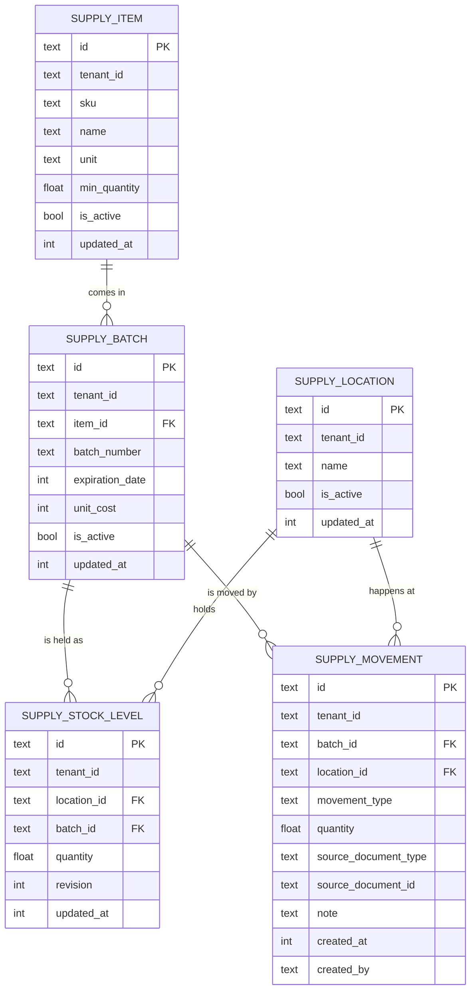

> Read AGENTS.md at the repo root before any change.

## Read this first — what is already done

The module is **written, compiles and passes its tests** (`gotest` is green before you touch anything). The previous
attempts of this plan lost work by running destructive git commands and by guessing APIs, so the domain code, the
operations, the screens and the demo data were written and tested by hand and are committed on `main`. **Do not rewrite,
move or delete any of them.** Your work is two things: **Stage 1 — the tests that are still missing** and **Stage 2 — the
documentation**, both specified below down to the cases. If a case below fails because the code is wrong, say so in the PR
(file, line, what the case expected); do not change the domain code to make a test pass.

**Git rules for this session (non-negotiable):** run `git add -A && git commit && git push` after every test file and
every document, so nothing can be lost. Never run `git reset`, `git restore`, `git checkout <path>`, `git stash` or
`git clean`; if a file is wrong, edit it. A session that ends without a pull request is a failed delivery: open it when the
last stage is done, or earlier with what you have if you are blocked, listing what is missing.

## Tools

Set these in every shell that runs `go` (the `webtyp.com/*` modules resolve to GitHub; without them the public proxy cannot
fetch them): `export GOPRIVATE='webtyp.com/*,github.com/veltylabs/*'` and `export GOFLAGS=-mod=mod`.

```
go install webtyp.com/devflow/cmd/gotest@latest
go install webtyp.com/lang/cmd/langc@latest
```

Run the suite with `gotest` (never `go test` for the final check). Write files with a file-writing tool, never with shell
heredocs appended to Go files; run `gofmt -l .` and `go build ./...` after each file.

## What is in the repository

| File | What it is |
|---|---|
| `model.go`, `model_orm.go` | the five tables and every argument model; `model_orm.go` is generated by `ormc`, never edit it |
| `errors.go` | every error constant (all messages start `supply: `), `statusOf`, `writeError` |
| `module.go` | `Deps`, `Module`, `New`, and the four stock operations `ReceiveStock`, `RegisterEntry`, `RegisterOutput`, `TransferStock`; cost facts and events |
| `crud.go` | item and location update / upsert / patch / deactivate / delete |
| `queries.go`, `reports.go` | the lists, `ListExpiring`, `ListLowStock` and the readers |
| `ops.go` | the operation names, the wire shapes the generic view sends, `MountOperations` and every handler |
| `view.go` | `NewItemView`, `NewLocationView` |
| `migrate/migrate.go` | creates the five tables in foreign-key order |
| `ui/`, `seed/`, `web/` | the screen group "Insumos", the demo data, the in-browser demo |
| `lang.json` | the Spanish of the form labels and of the option labels (generated with `langc sync .`) |
| `conflict_internal_test.go` | the stale-revision test (root-level, justified) |
| `tests/setup_test.go` | helpers: `newModule`, `newItem`, `newLocation`, `testTenant`, `testIDGen` |
| `tests/receive_test.go`, `output_test.go`, `reports_test.go`, `ops_test.go`, `ui_test.go`, `seed_test.go`, `mount_test.go`, `conformance_test.go`, `ledger_test.go` | tests that exist: use them as the style of yours |

## APIs used — exact signatures; never guess or adapt them

If a signature in the repository differs from this table, stop and name the symbol in the PR.

The module (package `supplymanager`, import `github.com/veltylabs/supply_manager`):

```go
NewItemView(caller router.Caller) view.Presenter
NewLocationView(caller router.Caller) view.Presenter
(a *DeleteIdsArgs) DecodeFields(r model.FieldReader)
(a *DeleteIdsArgs) EncodeFields(w model.FieldWriter)
(a *DeleteIdsArgs) IsNil() bool
(a *DeleteIdsArgs) ModelName() string
(a *DeleteIdsArgs) Pointers() []any
(a *DeleteIdsArgs) Schema() []model.Field
(m *ExpiringStock) DecodeFields(r model.FieldReader)
(m *ExpiringStock) EncodeFields(w model.FieldWriter)
(m *ExpiringStock) IsNil() bool
(m *ExpiringStock) ModelName() string
(m *ExpiringStock) Pointers() []any
(m *ExpiringStock) Schema() []model.Field
(m *ExpiringStock) Validate(action byte) error
(s *ExpiringStockList) Append() model.Fielder
(s *ExpiringStockList) At(i int) model.Fielder
(s *ExpiringStockList) DecodeFields(_ model.FieldReader)
(s *ExpiringStockList) EncodeFields(_ model.FieldWriter)
(s *ExpiringStockList) IsNil() bool
(s *ExpiringStockList) Len() int
(m *IdArgs) DecodeFields(r model.FieldReader)
(m *IdArgs) EncodeFields(w model.FieldWriter)
(m *IdArgs) IsNil() bool
(m *IdArgs) ModelName() string
(m *IdArgs) Pointers() []any
(m *IdArgs) Schema() []model.Field
(m *IdArgs) Validate(action byte) error
(s *IdArgsList) Append() model.Fielder
(s *IdArgsList) At(i int) model.Fielder
(s *IdArgsList) DecodeFields(_ model.FieldReader)
(s *IdArgsList) EncodeFields(_ model.FieldWriter)
(s *IdArgsList) IsNil() bool
(s *IdArgsList) Len() int
(m *ListBatchesArgs) DecodeFields(r model.FieldReader)
(m *ListBatchesArgs) EncodeFields(w model.FieldWriter)
(m *ListBatchesArgs) IsNil() bool
(m *ListBatchesArgs) ModelName() string
(m *ListBatchesArgs) Pointers() []any
(m *ListBatchesArgs) Schema() []model.Field
(m *ListBatchesArgs) Validate(action byte) error
(s *ListBatchesArgsList) Append() model.Fielder
(s *ListBatchesArgsList) At(i int) model.Fielder
(s *ListBatchesArgsList) DecodeFields(_ model.FieldReader)
(s *ListBatchesArgsList) EncodeFields(_ model.FieldWriter)
(s *ListBatchesArgsList) IsNil() bool
(s *ListBatchesArgsList) Len() int
(m *ListExpiringArgs) DecodeFields(r model.FieldReader)
(m *ListExpiringArgs) EncodeFields(w model.FieldWriter)
(m *ListExpiringArgs) IsNil() bool
(m *ListExpiringArgs) ModelName() string
(m *ListExpiringArgs) Pointers() []any
(m *ListExpiringArgs) Schema() []model.Field
(m *ListExpiringArgs) Validate(action byte) error
(s *ListExpiringArgsList) Append() model.Fielder
(s *ListExpiringArgsList) At(i int) model.Fielder
(s *ListExpiringArgsList) DecodeFields(_ model.FieldReader)
(s *ListExpiringArgsList) EncodeFields(_ model.FieldWriter)
(s *ListExpiringArgsList) IsNil() bool
(s *ListExpiringArgsList) Len() int
(m *ListItemsArgs) DecodeFields(r model.FieldReader)
(m *ListItemsArgs) EncodeFields(w model.FieldWriter)
(m *ListItemsArgs) IsNil() bool
(m *ListItemsArgs) ModelName() string
(m *ListItemsArgs) Pointers() []any
(m *ListItemsArgs) Schema() []model.Field
(m *ListItemsArgs) Validate(action byte) error
(s *ListItemsArgsList) Append() model.Fielder
(s *ListItemsArgsList) At(i int) model.Fielder
(s *ListItemsArgsList) DecodeFields(_ model.FieldReader)
(s *ListItemsArgsList) EncodeFields(_ model.FieldWriter)
(s *ListItemsArgsList) IsNil() bool
(s *ListItemsArgsList) Len() int
(m *ListLocationsArgs) DecodeFields(r model.FieldReader)
(m *ListLocationsArgs) EncodeFields(w model.FieldWriter)
(m *ListLocationsArgs) IsNil() bool
(m *ListLocationsArgs) ModelName() string
(m *ListLocationsArgs) Pointers() []any
(m *ListLocationsArgs) Schema() []model.Field
(m *ListLocationsArgs) Validate(action byte) error
(s *ListLocationsArgsList) Append() model.Fielder
(s *ListLocationsArgsList) At(i int) model.Fielder
(s *ListLocationsArgsList) DecodeFields(_ model.FieldReader)
(s *ListLocationsArgsList) EncodeFields(_ model.FieldWriter)
(s *ListLocationsArgsList) IsNil() bool
(s *ListLocationsArgsList) Len() int
(m *ListLowStockArgs) DecodeFields(r model.FieldReader)
(m *ListLowStockArgs) EncodeFields(w model.FieldWriter)
(m *ListLowStockArgs) IsNil() bool
(m *ListLowStockArgs) ModelName() string
(m *ListLowStockArgs) Pointers() []any
(m *ListLowStockArgs) Schema() []model.Field
(m *ListLowStockArgs) Validate(action byte) error
(s *ListLowStockArgsList) Append() model.Fielder
(s *ListLowStockArgsList) At(i int) model.Fielder
(s *ListLowStockArgsList) DecodeFields(_ model.FieldReader)
(s *ListLowStockArgsList) EncodeFields(_ model.FieldWriter)
(s *ListLowStockArgsList) IsNil() bool
(s *ListLowStockArgsList) Len() int
(m *ListMovementsArgs) DecodeFields(r model.FieldReader)
(m *ListMovementsArgs) EncodeFields(w model.FieldWriter)
(m *ListMovementsArgs) IsNil() bool
(m *ListMovementsArgs) ModelName() string
(m *ListMovementsArgs) Pointers() []any
(m *ListMovementsArgs) Schema() []model.Field
(m *ListMovementsArgs) Validate(action byte) error
(s *ListMovementsArgsList) Append() model.Fielder
(s *ListMovementsArgsList) At(i int) model.Fielder
(s *ListMovementsArgsList) DecodeFields(_ model.FieldReader)
(s *ListMovementsArgsList) EncodeFields(_ model.FieldWriter)
(s *ListMovementsArgsList) IsNil() bool
(s *ListMovementsArgsList) Len() int
(m *ListStockArgs) DecodeFields(r model.FieldReader)
(m *ListStockArgs) EncodeFields(w model.FieldWriter)
(m *ListStockArgs) IsNil() bool
(m *ListStockArgs) ModelName() string
(m *ListStockArgs) Pointers() []any
(m *ListStockArgs) Schema() []model.Field
(m *ListStockArgs) Validate(action byte) error
(s *ListStockArgsList) Append() model.Fielder
(s *ListStockArgsList) At(i int) model.Fielder
(s *ListStockArgsList) DecodeFields(_ model.FieldReader)
(s *ListStockArgsList) EncodeFields(_ model.FieldWriter)
(s *ListStockArgsList) IsNil() bool
(s *ListStockArgsList) Len() int
(m *LowStock) DecodeFields(r model.FieldReader)
(m *LowStock) EncodeFields(w model.FieldWriter)
(m *LowStock) IsNil() bool
(m *LowStock) ModelName() string
(m *LowStock) Pointers() []any
(m *LowStock) Schema() []model.Field
(m *LowStock) Validate(action byte) error
(s *LowStockList) Append() model.Fielder
(s *LowStockList) At(i int) model.Fielder
(s *LowStockList) DecodeFields(_ model.FieldReader)
(s *LowStockList) EncodeFields(_ model.FieldWriter)
(s *LowStockList) IsNil() bool
(s *LowStockList) Len() int
New(db *orm.DB, deps Deps) (*Module, error)
(m *Module) CreateItem(p SupplyItem) (SupplyItem, error)
(m *Module) CreateLocation(l SupplyLocation) (SupplyLocation, error)
(m *Module) DeactivateItem(tenantId, id string) error
(m *Module) DeleteItems(ids []string) error
(m *Module) DeleteLocations(ids []string) error
(m *Module) GetBatch(tenantId, id string) (SupplyBatch, error)
(m *Module) GetItem(tenantId, id string) (SupplyItem, error)
(m *Module) GetLocation(tenantId, id string) (SupplyLocation, error)
(m *Module) ItemCard(tenantId, itemId string) (name, unit string, active bool, err error)
(m *Module) ItemExists(tenantId, itemId string) (bool, error)
(m *Module) ListBatches(tenantId, itemId string) ([]SupplyBatch, error)
(m *Module) ListExpiring(a ListExpiringArgs) ([]ExpiringStock, error)
(m *Module) ListItems(a ListItemsArgs) ([]SupplyItem, error)
(m *Module) ListLocations(a ListLocationsArgs) ([]SupplyLocation, error)
(m *Module) ListLowStock(a ListLowStockArgs) ([]LowStock, error)
(m *Module) ListMovements(a ListMovementsArgs) ([]SupplyMovement, error)
(m *Module) ListStock(a ListStockArgs) ([]SupplyStockLevel, error)
(m *Module) ModelName() string
(m *Module) MountOperations(reg router.OperationRegistry)
(m *Module) PatchItems(ids, fields []string, rec SupplyItem) error
(m *Module) PatchLocations(ids, fields []string, rec SupplyLocation) error
(m *Module) ReceiveStock(a ReceiveStockArgs) (SupplyMovement, error)
(m *Module) RegisterEntry(a RegisterEntryArgs) (SupplyMovement, error)
(m *Module) RegisterOutput(a RegisterOutputArgs) ([]SupplyMovement, error)
(m *Module) TransferStock(a TransferStockArgs) ([]SupplyMovement, error)
(m *Module) UpdateItem(p SupplyItem) (SupplyItem, error)
(m *Module) UpdateLocation(l SupplyLocation) (SupplyLocation, error)
(m *Module) UpsertItem(p SupplyItem) (SupplyItem, error)
(m *Module) UpsertLocation(l SupplyLocation) (SupplyLocation, error)
(m *ReceiveStockArgs) DecodeFields(r model.FieldReader)
(m *ReceiveStockArgs) EncodeFields(w model.FieldWriter)
(m *ReceiveStockArgs) IsNil() bool
(m *ReceiveStockArgs) ModelName() string
(m *ReceiveStockArgs) Pointers() []any
(m *ReceiveStockArgs) Schema() []model.Field
(m *ReceiveStockArgs) Validate(action byte) error
(s *ReceiveStockArgsList) Append() model.Fielder
(s *ReceiveStockArgsList) At(i int) model.Fielder
(s *ReceiveStockArgsList) DecodeFields(_ model.FieldReader)
(s *ReceiveStockArgsList) EncodeFields(_ model.FieldWriter)
(s *ReceiveStockArgsList) IsNil() bool
(s *ReceiveStockArgsList) Len() int
(m *RegisterEntryArgs) DecodeFields(r model.FieldReader)
(m *RegisterEntryArgs) EncodeFields(w model.FieldWriter)
(m *RegisterEntryArgs) IsNil() bool
(m *RegisterEntryArgs) ModelName() string
(m *RegisterEntryArgs) Pointers() []any
(m *RegisterEntryArgs) Schema() []model.Field
(m *RegisterEntryArgs) Validate(action byte) error
(s *RegisterEntryArgsList) Append() model.Fielder
(s *RegisterEntryArgsList) At(i int) model.Fielder
(s *RegisterEntryArgsList) DecodeFields(_ model.FieldReader)
(s *RegisterEntryArgsList) EncodeFields(_ model.FieldWriter)
(s *RegisterEntryArgsList) IsNil() bool
(s *RegisterEntryArgsList) Len() int
(m *RegisterOutputArgs) DecodeFields(r model.FieldReader)
(m *RegisterOutputArgs) EncodeFields(w model.FieldWriter)
(m *RegisterOutputArgs) IsNil() bool
(m *RegisterOutputArgs) ModelName() string
(m *RegisterOutputArgs) Pointers() []any
(m *RegisterOutputArgs) Schema() []model.Field
(m *RegisterOutputArgs) Validate(action byte) error
(s *RegisterOutputArgsList) Append() model.Fielder
(s *RegisterOutputArgsList) At(i int) model.Fielder
(s *RegisterOutputArgsList) DecodeFields(_ model.FieldReader)
(s *RegisterOutputArgsList) EncodeFields(_ model.FieldWriter)
(s *RegisterOutputArgsList) IsNil() bool
(s *RegisterOutputArgsList) Len() int
ReadOneSupplyBatch(qb *orm.QB, model *SupplyBatch) (*SupplyBatch, error)
(m *SupplyBatch) DecodeFields(r model.FieldReader)
(m *SupplyBatch) EncodeFields(w model.FieldWriter)
(m *SupplyBatch) IsNil() bool
(m *SupplyBatch) ModelName() string
(m *SupplyBatch) Pointers() []any
(m *SupplyBatch) Schema() []model.Field
(m *SupplyBatch) SchemaExt() []model.FieldExt
(m *SupplyBatch) Validate(action byte) error
ReadAllSupplyBatch(qb *orm.QB) (SupplyBatchList, error)
(s *SupplyBatchList) Append() model.Fielder
(s *SupplyBatchList) At(i int) model.Fielder
(s *SupplyBatchList) DecodeFields(_ model.FieldReader)
(s *SupplyBatchList) EncodeFields(_ model.FieldWriter)
(s *SupplyBatchList) IsNil() bool
(s *SupplyBatchList) Len() int
ReadOneSupplyItem(qb *orm.QB, model *SupplyItem) (*SupplyItem, error)
(m *SupplyItem) DecodeFields(r model.FieldReader)
(m *SupplyItem) EncodeFields(w model.FieldWriter)
(m *SupplyItem) IsNil() bool
(m *SupplyItem) Item() view.Item
(m *SupplyItem) ModelName() string
(m *SupplyItem) Pointers() []any
(m *SupplyItem) Schema() []model.Field
(m *SupplyItem) Validate(action byte) error
ReadAllSupplyItem(qb *orm.QB) (SupplyItemList, error)
(s *SupplyItemList) Append() model.Fielder
(s *SupplyItemList) At(i int) model.Fielder
(s *SupplyItemList) DecodeFields(_ model.FieldReader)
(s *SupplyItemList) EncodeFields(_ model.FieldWriter)
(s *SupplyItemList) IsNil() bool
(s *SupplyItemList) Len() int
ReadOneSupplyLocation(qb *orm.QB, model *SupplyLocation) (*SupplyLocation, error)
(m *SupplyLocation) DecodeFields(r model.FieldReader)
(m *SupplyLocation) EncodeFields(w model.FieldWriter)
(m *SupplyLocation) IsNil() bool
(m *SupplyLocation) Item() view.Item
(m *SupplyLocation) ModelName() string
(m *SupplyLocation) Pointers() []any
(m *SupplyLocation) Schema() []model.Field
(m *SupplyLocation) Validate(action byte) error
ReadAllSupplyLocation(qb *orm.QB) (SupplyLocationList, error)
(s *SupplyLocationList) Append() model.Fielder
(s *SupplyLocationList) At(i int) model.Fielder
(s *SupplyLocationList) DecodeFields(_ model.FieldReader)
(s *SupplyLocationList) EncodeFields(_ model.FieldWriter)
(s *SupplyLocationList) IsNil() bool
(s *SupplyLocationList) Len() int
ReadOneSupplyMovement(qb *orm.QB, model *SupplyMovement) (*SupplyMovement, error)
(m *SupplyMovement) DecodeFields(r model.FieldReader)
(m *SupplyMovement) EncodeFields(w model.FieldWriter)
(m *SupplyMovement) IsNil() bool
(m *SupplyMovement) ModelName() string
(m *SupplyMovement) Pointers() []any
(m *SupplyMovement) Schema() []model.Field
(m *SupplyMovement) SchemaExt() []model.FieldExt
(m *SupplyMovement) Validate(action byte) error
ReadAllSupplyMovement(qb *orm.QB) (SupplyMovementList, error)
(s *SupplyMovementList) Append() model.Fielder
(s *SupplyMovementList) At(i int) model.Fielder
(s *SupplyMovementList) DecodeFields(_ model.FieldReader)
(s *SupplyMovementList) EncodeFields(_ model.FieldWriter)
(s *SupplyMovementList) IsNil() bool
(s *SupplyMovementList) Len() int
ReadOneSupplyStockLevel(qb *orm.QB, model *SupplyStockLevel) (*SupplyStockLevel, error)
(m *SupplyStockLevel) DecodeFields(r model.FieldReader)
(m *SupplyStockLevel) EncodeFields(w model.FieldWriter)
(m *SupplyStockLevel) IsNil() bool
(m *SupplyStockLevel) ModelName() string
(m *SupplyStockLevel) Pointers() []any
(m *SupplyStockLevel) Schema() []model.Field
(m *SupplyStockLevel) SchemaExt() []model.FieldExt
(m *SupplyStockLevel) Validate(action byte) error
ReadAllSupplyStockLevel(qb *orm.QB) (SupplyStockLevelList, error)
(s *SupplyStockLevelList) Append() model.Fielder
(s *SupplyStockLevelList) At(i int) model.Fielder
(s *SupplyStockLevelList) DecodeFields(_ model.FieldReader)
(s *SupplyStockLevelList) EncodeFields(_ model.FieldWriter)
(s *SupplyStockLevelList) IsNil() bool
(s *SupplyStockLevelList) Len() int
(m *TransferStockArgs) DecodeFields(r model.FieldReader)
(m *TransferStockArgs) EncodeFields(w model.FieldWriter)
(m *TransferStockArgs) IsNil() bool
(m *TransferStockArgs) ModelName() string
(m *TransferStockArgs) Pointers() []any
(m *TransferStockArgs) Schema() []model.Field
(m *TransferStockArgs) Validate(action byte) error
(s *TransferStockArgsList) Append() model.Fielder
(s *TransferStockArgsList) At(i int) model.Fielder
(s *TransferStockArgsList) DecodeFields(_ model.FieldReader)
(s *TransferStockArgsList) EncodeFields(_ model.FieldWriter)
(s *TransferStockArgsList) IsNil() bool
(s *TransferStockArgsList) Len() int
(a *UpdateItemArgs) DecodeFields(r model.FieldReader)
(a *UpdateItemArgs) EncodeFields(w model.FieldWriter)
(a *UpdateItemArgs) IsNil() bool
(a *UpdateItemArgs) ModelName() string
(a *UpdateItemArgs) Pointers() []any
(a *UpdateItemArgs) Schema() []model.Field
(a *UpdateLocationArgs) DecodeFields(r model.FieldReader)
(a *UpdateLocationArgs) EncodeFields(w model.FieldWriter)
(a *UpdateLocationArgs) IsNil() bool
(a *UpdateLocationArgs) ModelName() string
(a *UpdateLocationArgs) Pointers() []any
(a *UpdateLocationArgs) Schema() []model.Field
(a *UpsertItemArgs) DecodeFields(r model.FieldReader)
(a *UpsertItemArgs) EncodeFields(w model.FieldWriter)
(a *UpsertItemArgs) IsNil() bool
(a *UpsertItemArgs) ModelName() string
(a *UpsertItemArgs) Pointers() []any
(a *UpsertItemArgs) Schema() []model.Field
(a *UpsertLocationArgs) DecodeFields(r model.FieldReader)
(a *UpsertLocationArgs) EncodeFields(w model.FieldWriter)
(a *UpsertLocationArgs) IsNil() bool
(a *UpsertLocationArgs) ModelName() string
(a *UpsertLocationArgs) Pointers() []any
(a *UpsertLocationArgs) Schema() []model.Field
(v ValidationError) Error() string
```

Test helpers already in `tests/`:

```go
const testTenant = "tenant-1"
func newModule(t *testing.T) *supplymanager.Module                                     // in-memory database, no events
func newItem(t *testing.T, m *supplymanager.Module, sku string) supplymanager.SupplyItem        // an active item (unit BOX) with the given sku
func newLocation(t *testing.T, m *supplymanager.Module, name string) supplymanager.SupplyLocation     // active location
func receive(itemId, locationId, batch string, expiry int64, quantity float64) supplymanager.ReceiveStockArgs
func output(itemId, locationId string, t stock.Movement, quantity float64) supplymanager.RegisterOutputArgs
func call(t *testing.T, c router.Caller, op string, args model.Encodable, out model.Decodable) error // runs one operation through loopback.New(m)
type testIDGen struct{ n int }                                                 // implements model.IDGenerator
```

Libraries (published tags; read their README if in doubt):

```go
// webtyp.com/stock v0.1.0
const SecondsPerDay = 86400
type Movement string // Purchase, AdjustIn, TransferIn, AdjustOut, Sale, InternalUse, TransferOut
// webtyp.com/time v0.5.8
func Now() int64 // Unix seconds UTC
// webtyp.com/events v0.1.0 and webtyp.com/events/mock
type Event struct { Topic string; Payload model.Encodable }
type Handler func(Event)
type Subscription interface{ Cancel() }
// (*mock.Broker).Publish(events.Event); (*mock.Broker).Subscribe(topic string, h events.Handler) events.Subscription
// webtyp.com/money v0.1.0
func Subscribe(s events.Subscriber, sink Sink, onError func(error)) error
type Sink interface{ Accept(f Fact) error }
// webtyp.com/orm v0.12.10 and webtyp.com/storage/mem
func New(conn storage.Conn) *DB // orm.New(mem.New())
```

Money amounts are whole Chilean pesos; quantities are `float64`; times are Unix seconds UTC.

## Stage 1 — the missing tests (`tests/`, package `tests`)

Style: standard library only, one behaviour per test, `t.Run` for tables, errors compared with `==` to the module's
constants, a test never depends on another. Every case below is **setup → call → expected**. Group them in the files named.
`tests/ledger_test.go` is the only file with `//go:build !wasm`; yours need no tag unless they import `stocktest`.

### `tests/crud_test.go` — the items and the locations

Use `newModule(t)`, `newItem`, `newLocation`. `ValidationError` is `supplymanager.ValidationError` (compare its `.Err`).

| Test | Setup | Call | Expected |
|---|---|---|---|
| `TestCreateItem_StoresIt` | `newItem(t, m, "a1")` | `m.GetItem(testTenant, created.Id)` | same sku, name and unit; `UpdatedAt > 0` |
| `TestCreateItem_SkuIsUniquePerTenant` | one item with sku `a1` in `testTenant` | `CreateItem` with sku `a1` in `testTenant`, then in `"tenant-2"` | `ErrSkuExists` the first time; created the second time |
| `TestGetItem_ForeignTenant` | a item of `testTenant` | `m.GetItem("tenant-2", id)` | `ErrItemNotFound` |
| `TestUpdateItem` | two items `a1`, `a2` | `UpdateItem` of `a1` with a new name; then `UpdateItem` of `a1` with sku `a2`; then of an unknown id | name changed and the other fields kept; `ErrSkuExists`; `ErrItemNotFound` |
| `TestPatchItems` | a item | `PatchItems([id], ["name"], record with another name and another unit)`; then `PatchItems([id], ["bogus"], record)` | only the name changed (the unit kept); the second is a `ValidationError` whose `.Err` is `ErrUnknownField` |
| `TestDeactivateItem` | a item, a location | `DeactivateItem`; then `ListItems(ActiveOnly: true)`; then `ReceiveStock` | the item is not listed; `ErrItemInactive` |
| `TestDeleteItems` | two items, only one with a received batch | `DeleteItems` of the empty one; of the one with a batch; of an unknown id | removed (`GetItem` → `ErrItemNotFound`); `ErrItemInUse` and still there; `ErrItemNotFound` |
| `TestListItems_PagedAndFiltered` | 3 items named `A`, `B`, `C` (`B` deactivated) | `ListItems(Limit: 2, Offset: 1)`; `ListItems(ActiveOnly: true)` | `B`, `C`; `A`, `C` |
| `TestCreateLocation_NameIsUniquePerTenant` | a location `Store` | `CreateLocation` `Store` in `testTenant`, then in `"tenant-2"` | `ErrLocationNameExists`; created |
| `TestUpdateLocation` | locations `Store`, `Counter` | `UpdateLocation` of `Store` renamed `Counter`; then renamed `Warehouse` | `ErrLocationNameExists`; renamed |
| `TestDeleteLocations` | one empty location, one holding stock | `DeleteLocations` of each | removed; `ErrLocationInUse` |
| `TestInactiveLocationRefusesReceipts` | a item, a location updated with `IsActive: false` | `ReceiveStock` | `ErrLocationInactive` |
| `TestItemExists` | an active item, a deactivated one | `ItemExists` of: the active, the deactivated, an unknown id, the active with `"tenant-2"` | `true`; `false`; `false`; `false` (never an error) |

Rules that only the supplies have (same file):

| Test | Setup | Call | Expected |
|---|---|---|---|
| `TestCreateItem_Rules` | none | `CreateItem` with: `Unit: "BAG"`; `Name: ""` | `ErrUnit`; a `ValidationError` |
| `TestItemCard` | an item (name `Surgical gloves`, `UnitPair`) | `ItemCard`; then of an unknown id | name, unit and `active == true`; `ErrNotFound` |

### `tests/stock_test.go` — transfers, entries, costs, the ledger

| Test | Setup | Call | Expected |
|---|---|---|---|
| `TestTransferStock_MovesTheSameBatches` | a item; locations `A`, `B`; 10 received in `A` (batch `L1`) | `TransferStock` of 4 from `A` to `B` | `ListStock` shows 6 in `A` and 4 in `B`, **same `BatchId`**; the movements are `stock.TransferOut` 4 at `A` and `stock.TransferIn` 4 at `B` |
| `TestTransferStock_Rules` | the same setup | `TransferStock` from `A` to `A`; of 11 from `A` to `B` | `ErrSameLocation`; `ErrInsufficientStock` **and both locations unchanged** |
| `TestRegisterEntry` | a item with batch `L1` (10 received) | `RegisterEntry` of 3 on that batch; of 3 on a batch of another product; of 0 | the level is 13 and the movement is `stock.AdjustIn`; `ErrBatchNotFound`; a `ValidationError` |
| `TestReceiveStock_CostRules` | a item | `ReceiveStock` batch `L1` cost 100, then the same batch with cost 200, then with cost 0 | created with cost 100; `ErrBatchCostMismatch`; accepted and the cost **stays 100** (`ListBatches`) |
| `TestListMovements` | 3 movements on one item (a receipt and two outputs) | `ListMovements` with no limit; with `Limit: 2`; with `BatchId` of another batch | newest first (3); the 2 newest; none |

### `tests/tenant_test.go` — isolation

| Test | Setup | Call | Expected |
|---|---|---|---|
| `TestTenantIsolation` | in `testTenant`: a item, a location, a received batch | with `"tenant-2"`: `ListItems`, `ListStock`, `ReceiveStock` using the item and location of `testTenant`, `GetBatch` of its batch | both lists empty; `ErrItemNotFound`; `ErrBatchNotFound` |

### `tests/events_test.go` — events and cost facts

Build the module with `Deps{IDs: &testIDGen{}, Publisher: broker}` where `broker := &mock.Broker{}`; count the events with `broker.Subscribe(supplymanager.TopicMovementRegistered, func(events.Event){ n++ })`.

| Test | Setup | Call | Expected |
|---|---|---|---|
| `TestEvents_OnePerMovement` | a item, locations `A`, `B`, two batches of 5 received (2 events) | `RegisterOutput` of 7 (draws both batches); then `TransferStock` of 1 | 2 more events for the output, then 2 for the transfer (out + in): 6 in total |
| `TestEvents_NilPublisherIsSilent` | `newModule(t)` (no publisher) | receive and output | no panic, no error |
| `TestEvents_FailedOperationPublishesNothing` | a item with 5 in stock | `RegisterOutput` of 6 | `ErrInsufficientStock` and the counter did not move |
| `TestCostFacts_OnlyWithScopeAndCost` | a `recordingSink` subscribed with `money.Subscribe` (see `tests/output_test.go`); a item with a batch of cost 100 | output with `MoneyScope: ""`; output of a batch with cost 0 and `MoneyScope: "x"`; a transfer and an entry with cost and scope | no fact in any of the three cases |

## Stage 2 — documentation

Permanent docs never link `docs/PLAN.md`. English, plain, no marketing.

1. **`README.md`** (replace the stub text): what the module is and is not (2 short paragraphs: the clinical supplies (gloves, syringes, gauze): items, their batches (a supply may have no lot, it then uses `NoBatchNumber`; the expiry date is optional), the locations they are kept in and the append-only ledger of movements; supplies are not sold and have no price, and what is used in a consultation is recorded by `clinical_encounter` as a `stock.InternalUse` output that carries the encounter id); a Quick Start of
   about 20 lines building `New(db, Deps{IDs: ids, Publisher: broker, MoneyScope: "supply"})`, creating a location and an item, receiving
   stock and registering an output; the **Ops table** (every `Op*` constant of `ops.go` with its resource and action, from
   `MountOperations`); the readers; the **cost fact** section (`Deps.MoneyScope` and `money.Consumed`, a purchase is never a fact
   of this module); a **Key files** table copied from the table above.
2. **`docs/ARCHITECTURE.md`**: scope; the entities and the rules of `Constants, vocabulary and rules` below (copy them); the
   dependency on `webtyp/stock` (no stock rule is written in this module) and `webtyp/money`; "no stock screen in this version";
   the composition-root example with `Deps{IDs, Publisher, MoneyScope}`; why `tenant_id` is absent from the operations the generic view
   drives (they resolve the row by id and use the tenant the row stores).
3. **`docs/diagrams/database.md`**: this Mermaid, verbatim, under a heading `# Database`:



## Constants, vocabulary and rules (copy into ARCHITECTURE.md)

- **All stock is held per batch.** The rules of stock (first expiry first out, expired lots, never negative, movement directions) are those of `webtyp.com/stock`; nothing in this module repeats them.
- **A movement is append-only**: there is no update and no delete; a mistake is corrected by a new movement. Its `quantity` is always greater than zero; the direction comes from the movement type.
- **Every stock change is one transaction** with an optimistic revision check on the stock level (`ErrConflict` when the row changed).
- **Cost**: a batch has an optional `unit_cost` (whole pesos per unit, 0 = unknown). With `Deps.Publisher` and `Deps.MoneyScope` set, each output movement whose batch has a cost publishes one `money.Consumed` fact (cost × quantity, rounded half away from zero). A purchase is never a fact of this module.
- **Events**: one `supply.movement.registered` per movement, after the commit.
- **Tenancy**: every query of a stock operation filters by `tenant_id`; the operations the generic view drives resolve the row by id and use the tenant the row stores.
- Units: `PIECE`, `BOX`, `PAIR`, `ML`, `GRAM`. Supplies have **no price, no tax treatment and no sale flag**.
- A batch's expiry is **optional** (0 = does not expire); a supply with no lot uses the batch number `NoBatchNumber` (`NO-BATCH`), passed explicitly.
- Outputs accepted: `stock.InternalUse` (the use in a consultation) and `stock.AdjustOut` (a write-off); `stock.Sale` is `ErrMovementType`. An expired batch is never used (`ErrBatchExpired`); only a write-off may take expired stock. `min_quantity` (0 = no alert) feeds `ListLowStock`.

## Delivery check

```
gotest                                                # vet, race and tests green
GOOS=js GOARCH=wasm go vet ./...                      # wasm lane compiles
gofmt -l . | grep -v model_orm.go                     # → empty
grep -rn "errors\." --include=*.go . | grep -v _test  # → empty (no stdlib errors)
grep -rn "map\[" --include=*.go . | grep -v model_orm.go  # → empty (no Go map anywhere, tests included)
grep -n '^replace' go.mod                             # → empty
git diff --stat main                                  # only the files of the stages: tests/*.go, README.md, docs/*
```

## Stages

| # | Stage | Files |
|---|---|---|
| 1 | tests | `tests/crud_test.go`, `tests/stock_test.go`, `tests/tenant_test.go`, `tests/events_test.go` |
| 2 | docs | `README.md`, `docs/ARCHITECTURE.md`, `docs/diagrams/database.md` |
